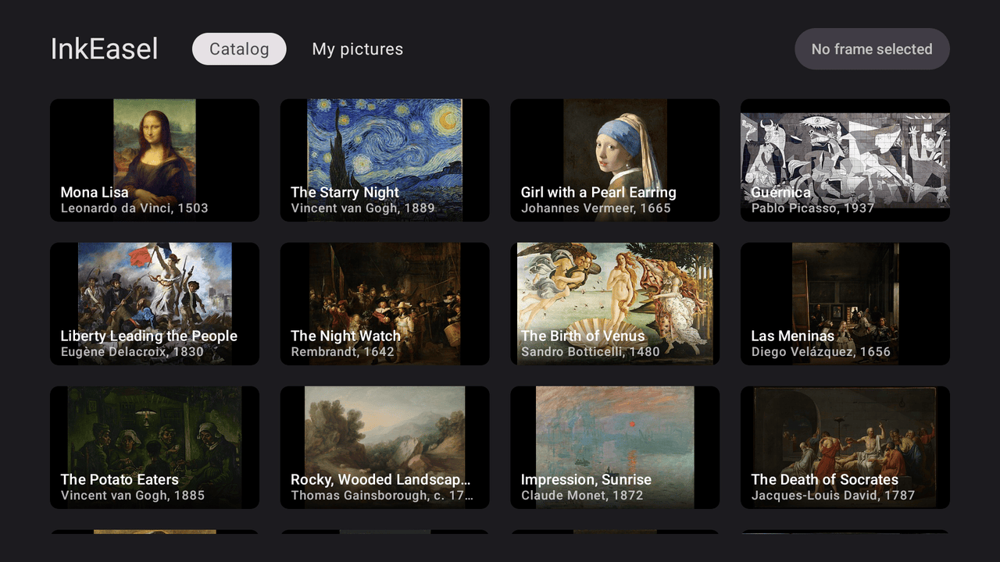
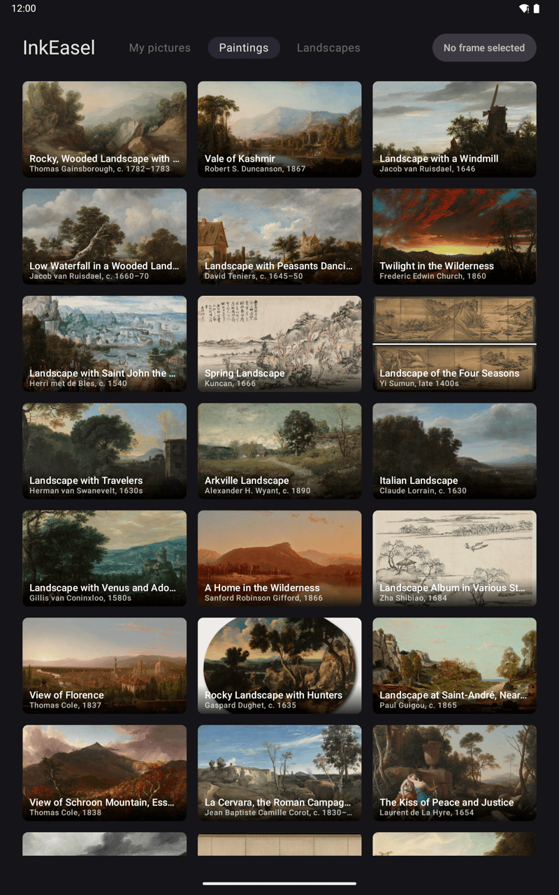
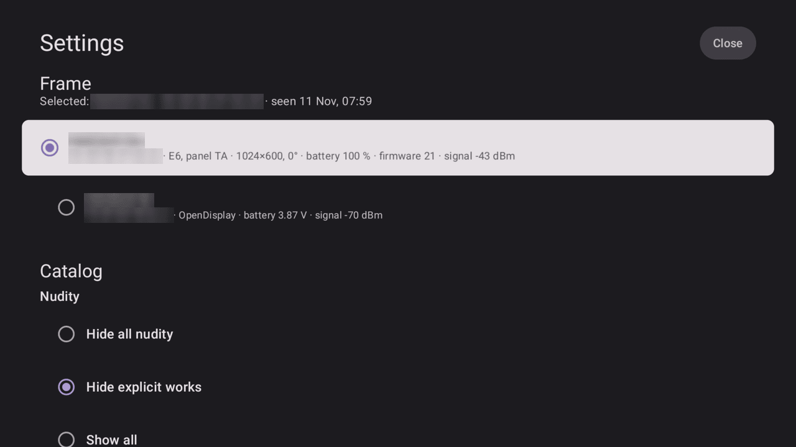

# InkEasel

Android TV app that uploads pictures to an e-paper frame over BLE: free paintings and photos from a
built-in catalog, your own pictures, and the poster of whatever is playing. When a film plays, its poster
goes to the frame; when playback ends, the frame returns to the last manually uploaded picture.
Made for a TV and its remote (D-pad); it also runs on tablets and phones, by touch and in any orientation,
where a picture can be shared to the frame from a gallery. Developed and tested on an NVIDIA Shield TV Pro
2019 (Android 11), the Android TV 14 emulator and an Android 15 tablet emulator.

License: [Apache-2.0](LICENSE).

| Android TV | Tablet |
|---|---|
|  |  |

## Supported frames

NowMean e-paper frames (BLE service `0xFFBB`). The app reads the frame's colour type, panel and resolution
from its advertisement and renders each picture for that panel:

- **E6 (Spectra 6)**: verified on a real frame (1024×600); most other E6 sizes use the same layout at
  another size and count as verified.
- **E6** 1360×480, 1440×600 and 1200×1600, **E4** and **BWR**: implemented from the vendor app's formats,
  not yet seen on a real frame; the settings say "not verified on hardware", and they can still be chosen.
- **BW, BP, E7, BWY**, a rotated panel or panel type A: listed with the reason and not selectable.

Details per resolution: "Choosing the frame" below. Other e-paper protocols are not supported yet.

## Install

Requirements: Android 8.0 or newer with Bluetooth LE; Android TV, a tablet or a phone.

- **APK**: tagged versions are published on the
  [Releases](https://github.com/hsw/inkeasel/releases) page as `inkeasel-<tag>.apk`, signed with the
  release key. On a phone or tablet open the file and allow installs from that app when asked. On Android TV
  install it from a computer with adb (enable Developer options → USB/network debugging on the TV first):

      adb connect <tv-ip>:5555
      adb install -r inkeasel-<tag>.apk

- **From source** (JDK 21, Android SDK path in `local.properties`):

      JAVA_HOME=<JDK 21> ./gradlew assembleDebug
      adb install -r app/build/outputs/apk/debug/app-debug.apk

  Unit tests (JVM, JUnit 4 + `kotlinx-coroutines-test`; same `JAVA_HOME`):

      ./gradlew testDebugUnitTest

On the first start the settings open by themselves: allow Bluetooth, wait for the frame to appear in the
list and select it.

## Permissions

- **Bluetooth** ("Nearby devices" on Android 12+, location on Android 11 and older, where the system also
  wants location turned on for a BLE scan): needed to find the frame and send pictures. The app asks on
  start and from **Settings**; if the system no longer shows its dialog, the settings name the path in App
  info.
- **Notification access** (optional, only for the now-playing poster): it lets the app read the
  media sessions of other apps (title and artwork of what plays). The app does not read notifications. There
  is no permission dialog for it: pressing the poster switch (or **Grant access**) in **Settings →
  Permissions and features** opens the system settings, and the poster turns on once you come back with the
  access granted:
  - phones and tablets open the system screen for InkEasel; on Android 13+ an APK installed outside a store
    may first need App info → ⋮ → "Allow restricted settings", and the section says so;
  - Android TV 12 and newer open the list of apps with notification access: select InkEasel there. The
    section also names the menu path below, in case the remote cannot reach the list (seen on Google TV 14);
  - Android TV 9–11 (e.g. the Shield) have the switch only in the menu: the app opens Settings → Apps and
    shows the path **Settings → Apps → Special app access → Notification access → InkEasel** (one press on
    InkEasel there grants it);
  - Android TV 8 has no screen for it at all, so the section shows the adb command (pictures work without it):

        adb shell cmd notification allow_listener io.github.hsw.inkeasel/io.github.hsw.inkeasel.nowplaying.NowPlayingListener

  The poster can be switched off in the same section without revoking the access.
- **Internet**: the catalogs and the posters (see Privacy).

## Privacy

InkEasel has no account, no analytics, no ads and no server of its own.

- What plays is read from the media sessions **on the device** and used only to pick and time the poster;
  it is not sent anywhere. The titles go to the device's own system log (logcat) for troubleshooting.
- Network traffic is limited to the picture sources: the catalog lists and images from the
  [Cleveland Museum of Art Open Access API](https://openaccess-api.clevelandart.org/) and
  [Wikimedia Commons](https://commons.wikimedia.org/), a picture URL given to the upload service, and the
  poster artwork, downloaded over https from the address the playing app publishes.
- Pictures are sent to the frame over BLE only. The chosen frame, the saved catalog lists and your
  pictures stay in the app's storage on the device (Android backup is off).

## Builds and releases

- **CI** (`.github/workflows/ci.yml`): every branch push and pull request runs
  `./gradlew testDebugUnitTest assembleDebug assembleRelease` on JDK 21 (the release build signed with the
  debug key, only to see it builds); the debug APK is kept as the run's artifact. A `v*` tag runs the release
  workflow instead.
- **Release signing** (`app/build.gradle.kts`): the release build is signed with the key given by four
  environment variables, `INKEASEL_KEYSTORE` (path to the keystore), `INKEASEL_KEYSTORE_PASSWORD`,
  `INKEASEL_KEY_ALIAS` and `INKEASEL_KEY_PASSWORD`. With none of them set, it is signed with the debug key
  and the build prints a warning; with only some set, a release build fails. Only the tasks that package or
  sign a release (`assembleRelease`, `bundleRelease`, …) check this, so `testReleaseUnitTest` and lint run
  without the variables. Check which key signed an APK
  with `apksigner verify --print-certs app/build/outputs/apk/release/app-release.apk` (from the SDK
  build-tools).
- **Releases** (`.github/workflows/release.yml`): pushing a tag `v*` runs the unit tests, builds the release
  APK signed with the release key and publishes it as a GitHub release `inkeasel-<tag>.apk` with generated
  notes. The build runs with a read-only token and no stored git credentials; a second job, which runs no
  build code, gets write access only to create the release from the built APK. It needs four repository secrets: `INKEASEL_KEYSTORE_BASE64` (the keystore file, base64-encoded),
  `INKEASEL_KEYSTORE_PASSWORD`, `INKEASEL_KEY_ALIAS`, `INKEASEL_KEY_PASSWORD`; without them the workflow
  stops before building and names the missing ones. Releases are never signed with the debug key.

## Language

The UI is in English, and in Russian when the device language (or the app's language in the system
settings, Android 13+: Settings → Apps → InkEasel → Language, listed from the locale config the build
generates from `res/`) is Russian. All texts are string resources: English in `res/values/strings.xml`,
Russian in `res/values-ru/strings.xml`. Code that runs as JVM unit tests has no `Context`, so it returns a
`Txt` (a string resource id and its format arguments, which may be `Txt` themselves) that the UI puts into
words where it is shown; an upload failure meant for the user is a `TxtException` carrying one. Other
exceptions (e.g. from the network library) are shown with their raw message. To check a language on a
device:

    adb shell cmd locale set-app-locales io.github.hsw.inkeasel --locales ru-RU   # or en-US

## Screens

Made for a TV and the D-pad; phones and tablets work by touch in any orientation. Rotating or resizing
does not restart the screen (the open tab, the settings and their frame list stay, and no permission is
asked twice); the layout follows the window width:

| Width         | Columns | Side padding | Header                                     |
|---------------|---------|--------------|--------------------------------------------|
| under 600 dp  | 2       | 16 dp        | name and frame button, tabs on a row below |
| 600–719 dp    | 3       | 32 dp        | as above                                   |
| 720–839 dp    | 3       | 32 dp        | one row                                    |
| 840 dp and up | 4       | 48 dp        | one row (a TV is 960 dp wide)              |

The tabs scroll sideways when they do not fit. The app draws behind the status and navigation bars
(Android 15 requires it) and keeps its content clear of them, with gesture or button navigation; the
settings dialog does the same. A TV has no bars, so nothing changes there.

## Catalog

Tabs: "My pictures" (the app's own folder on the device), "Paintings" (Cleveland Museum of Art, CC0) and
"Landscapes" (Wikimedia Commons featured pictures). A list request gives up after 20 s; Commons reads at
most 3 pages within 30 s and shows what came in by then, also when a later page fails. A source that
answers with no usable picture says so ("The source returned no pictures.") with **Retry**. A failure reads as a sentence (no connection, the
source is not responding, HTTP code, unreadable answer) with **Retry**.

The last good, non-empty list of each online tab is saved in the app's files (`files/catalog/<source>.json`).
When the source fails later, that list is shown with a note above it ("Saved list from <date>. <reason>")
and **Retry**; the list stays on screen while a retry runs, and the note goes once a fresh list arrives.
An empty answer never replaces a saved list, and a list cut short (by the 30 s limit or a failed later page)
replaces it only when it is not smaller. Thumbnails of a saved list come from the image cache, so
offline some may be missing; sending a picture still needs the network.

Known risk: the Cleveland API sometimes answers slowly (27 s seen) or with HTTP 504. If it takes longer
than 20 s every time, "Paintings" fails each time and its saved list fills only after a fast answer;
asking for fewer results than `limit=200` would be the next step then.

## Share → InkEasel

On a phone or a tablet, "Share" on a picture in a gallery or a file manager lists InkEasel. The picture is
copied into "My pictures" (the sender's file name, made safe, with the extension of its type; `-2`, `-3`, …
when the name is taken; `shared-<date>-<time>` when the sender gives none; at most 50 MB, written to a
`.part` file, created first so two shares at once never pick the same name, and renamed when complete;
an existing file is never overwritten) and sent to the frame as a manual upload, so it becomes the default
picture. The gallery stays on screen; a toast says the picture is saved and on its way to the frame. On
Android 13 and newer the app does not ask for the notification permission, so the result toast of an upload
started from a share (the gallery is in front) may not appear; open InkEasel or look at the frame to see
how it went. With no frame chosen the picture is only saved, and the share itself says so ("No frame selected:
choose one in the settings, then send it from there").

Only a `content://` picture of another app is taken (no `file://` paths, nothing of the app's own, also
with a `<user>@` prefix on the authority). Types:
JPEG, PNG, WebP, GIF, BMP and HEIC/HEIF (decoded by the system, Android 9+).

Without the Bluetooth permission the picture is still copied and waits: the app opens with its settings and
asks for the permission; once it is granted and a frame is chosen, the picture is sent. One share waits at a
time (the newest), for at most an hour (prefs `share`); after that, or if the file is gone, it is dropped,
and the picture stays in "My pictures" either way.

## Choosing the frame

Uploads go only to the frame chosen in **Settings → Frame**. Open it with the header button ("Frame: <name>"
or "No frame selected"); a fresh start with no frame chosen opens it by itself. The settings scroll as one
column (a phone in landscape is short); **Close** sits next to the title and has the first focus. Once
frames show up, the focus moves once to the chosen frame (or, if it has not shown up within 1.5 s, the first
one that can be chosen), unless the user has already moved onto the list.

- While it is open, the app scans for BLE service `0xFFBB` and lists every frame heard, one entry per name
  (the name is the frame's identity; its MAC may change), updated live: name, MAC, colour and panel type,
  resolution and rotation, battery, firmware, signal (RSSI) and safe mode if set. The chosen frame is marked.
  The scan stops when the screen closes or the app goes to the background.
- Selecting a frame saves it and closes the screen. **Close** or Back closes it with the frame unchanged.
- Frames the app cannot draw on are listed but greyed out with the reason ("not supported: …") and
  cannot be chosen. A supported frame whose format was never seen working on a real panel says
  "not verified on hardware" under its properties (and in a toast when chosen); it can be chosen.
- Supported (rotation 0° and a panel type other than A; formats from the vendor app, every
  type dithered with its own inks, sent raw with content marker MK 0):

  | Colour type | Resolutions | Payload | Verified on hardware |
  |---|---|---|---|
  | E6 (Spectra 6) | every size in the advertised table except 1360×480, 1440×600, 1200×1600 | 4 bpp, W·H/2 | yes (1024×600 seen; the rest is the same layout at another size) |
  | E6 | 1360×480, 1440×600 | 4 bpp, W·H/2 | no |
  | E6 | 1200×1600 | 4 bpp split: all left half rows, then all right half rows; 960,000 B | no |
  | BWR | every size except 1360×480, 1440×600 | black plane, then red plane, 1 bpp each, each padded to a multiple of 512 | no |
  | BWR | 1360×480, 1440×600 | split: left black, left red, right black, right red, each part padded to 512 (163,840 / 217,088 B) | no |
  | E4 | every size | 2 bpp, W·H/4 | no |

- Not supported, with the reason shown: BW and BP, E7 ("format not verified (the vendor app does not draw it
  correctly)"), BWY ("the vendor app cannot send to such frames"). Their
  palettes and packings are already described in `FrameFormats` and plug in by dropping the reason.
- The check and the render format (size, inks, packing, marker, verified flag) come from one place,
  `FrameFormats` in `FrameFormat.kt`, which works on protocol-neutral `FrameCaps` (taken from the
  advertisement here); a new panel type is one more entry there.
- Without Bluetooth permission the screen asks for it ("Allow"); with Bluetooth off it says so and
  offers the system Bluetooth settings. On Android 11 the scan also needs location on. Once the system no
  longer shows its dialog ("Don't allow" twice, or "don't ask again"), "Allow" would silently do nothing,
  so the button becomes "App info" and the text names the path: Settings → Apps → InkEasel → Permissions →
  Nearby devices (Location on Android 11 and older). The grant is picked up when the app comes back.
  A dialog closed without an answer (Back, a tap outside) is not a denial: "Allow" asks again. Only after a
  real denial has been seen once (remembered in prefs `permissions`) does a silent "no" count as blocked.

## Permissions and features

Below the frame list, **Settings → Permissions and features** collects what the app needs:

- **Bluetooth**: whether the permission is granted, with "Allow" (or "App info", as above) when it is not.
  One permission set everywhere (`BlePermissions`): Nearby devices (`BLUETOOTH_SCAN` + `BLUETOOTH_CONNECT`)
  on Android 12+, fine location before.
- **Now-playing poster**: an on/off switch and the state of the notification access it needs. The switch
  shows the poster as it works: on only while the poster is wanted (on by default, prefs `features`, key
  `poster`) **and** the access is granted (`PosterSwitch`). Pressing it while it is on switches the poster
  off; while it is off with the access, on. Without the access the switch stays off: the press is remembered
  (key `posterPending`) and starts the grant flow, and when the app comes back with the access granted the
  poster is switched on. If the access is revoked from outside, the switch shows off but the stored wish
  stays, so granting the access again brings the poster back. With the access missing (`ListenerAccessUi`):
  - phones and tablets: "Grant access" (and the switch) open the system screen: the app's own page
    (Android 11+), else the list of apps. On Android 13+ an app installed from an APK file (not from a store)
    may find the switch there greyed out ("Restricted setting"): the section says so and offers App info,
    where ⋮ → "Allow restricted settings" unlocks it (not shown when a store installed the app);
  - Android TV 12+: the list of apps (InkEasel is in it, one D-pad press grants it), plus the menu path as a
    fallback: "If the remote cannot reach the switch there, go back and use Settings → Apps → Special app
    access → Notification access → InkEasel" (on Google TV 14 the D-pad cannot reach the rows of that list);
  - Android TV 9–11 (the Shield): no such screen; "Grant access" opens Settings → Apps (the Settings home
    where that is missing) and the section names the same menu path;
  - Android TV 8, a low-RAM TV without the list screen (they hide the menu item), or any device where no
    settings screen resolves: the adb command, in small print (see "Now playing → poster").
- The states are read again whenever the app comes back to the front, e.g. from a system screen.

Switching the poster off stops new posters at once and puts the default picture back if a poster is on
the frame; see "Now playing → poster".

Stored in prefs `frame` (next to the upload spacing `endedAt` and the `onFrame` key):
`selected.kind` (the frame's protocol, `nowmean`), `selected.name`, `selected.address`, `selected.advert` (the raw manufacturer data as hex, the source of
truth), its parsed properties (`selected.colour`, `.panel`, `.width`, `.height`, `.rotation`, `.battery`,
`.firmware`, `.safeMode`, for reading the file only) and `selected.seenAt` (wall-clock ms when it was last
seen). The `address`/`name` keys of older builds (the first frame a scan found) are ignored and removed on
the first selection, so an existing install shows the picker once.

Uploading to the chosen frame: connect to the saved address; if that fails, scan **for that name only**
(15 s), save its new address and advertisement, and try again. It never switches to another frame. The
picture is rendered in the frame's format (size and inks from its advertisement); if a rescan shows the
frame now advertises other properties, the upload fails and the next one uses the new format.

**No frame chosen**: the catalog browses normally, but nothing is uploaded:
- a catalog tap toasts "No frame selected: choose one in the settings" and starts nothing;
- `UploadService` refuses a manual request (adb, debug build) before touching Bluetooth and toasts the same;
  the upload engine fails an automatic one before any download or Bluetooth and reports it to
  `FrameController` (so its key does not stay pending);
- `FrameController` schedules no poster and no revert, and logs `no frame selected: …`.

## Now playing → poster

Needs notification access, granted once, so the system binds the MediaSession reader: from **Settings →
Permissions and features** (see there), which leads to the system screen or, on Android TV 9–11 (the
Shield), to the menu Settings → Apps → Special app access → Notification access; on Android TV 8 only with
adb, as below. The system rebinds a granted listener after a
force-stop (verified on the Shield) and is expected to do the same after a reboot (platform behaviour, not
yet tested here); the binding keeps the process alive, also through HDMI-CEC standby, so no
`BOOT_COMPLETED` receiver is needed:

    adb shell cmd notification allow_listener io.github.hsw.inkeasel/io.github.hsw.inkeasel.nowplaying.NowPlayingListener
    adb shell dumpsys notification | grep -A3 'Live notification listeners'   # check: NowPlayingListener listed

How it works:
- The standard `MediaSession` metadata (title + artwork) of **any** app, read by `NowPlayingListener`, is
  turned into one `Playing(pkg, key, title, art, state, session)` event.
- **Key = the picture, not the title**: the art URL, or the SHA-1 of the artwork bitmap's pixels. Episodes
  of a series share one poster, so autoplay to the next episode does not redraw the frame.
- **Timing** (`FrameController`):
  - a poster goes up after **60 s** of continuous playback (skips trailers, short clips, channel surfing);
  - **60 s** after pause, stop or the session going away, the default picture goes back, but only if an
    automatic poster is on the frame; a session that keeps playing but moves on to an item without art
    counts as stopped; ends are matched by session, not by picture: only the playing session's pause,
    stop or departure ends playback (also if its item changed meanwhile), not that of another session (an
    earlier player, a helper session, another app), nor the playing session's own end while another
    session of the same app plays (or seeks or buffers while playing);
  - seeking and buffering are ignored (a session first seen buffering, e.g. after a restart, counts as
    playing), a session that clears its playback state counts as stopped; a failed poster upload is retried on the next transition into
    PLAYING, a failed revert every 60 s (at most 5 attempts in a row);
  - an upload takes tens of seconds over BLE, so its result is checked against what plays by then: a poster
    that lands after playback ended is reverted 60 s later, and a default that lands after the film resumed
    is followed by that film's poster 60 s later; a picture whose earlier request has no result yet is not
    requested again (e.g. pause/resume while the poster still waits for the frame to finish drawing), but
    if that earlier request then fails while the film still plays, the poster is requested again at once;
  - a manual upload during a film stays until the next transition into PLAYING (pause/resume, another film);
  - a revert or a poster decided while a manual upload was still queued or uploading is dropped once the
    manual upload succeeds (it would cover the user's pick); if the manual upload fails, it runs as usual;
  - after a process restart or a reboot, a poster left on the frame is reverted once the listener finds
    nothing playing; likewise when the listener reconnects and the app that was playing no longer plays.
- **Switched off** in the settings: what plays is still followed, but no poster is scheduled or uploaded
  (`poster off: not scheduled` in the log). Switching off cancels a pending start and reverts a poster on
  the frame at once; a poster whose upload was already under way is reverted at once when it lands, and
  one still queued in the upload engine is dropped. Reverts work as usual; if the process restarts before the
  switch's revert ran, the poster is reverted once the listener has reported the sessions again, even while
  the film plays. Switching on acts on what plays now: a film already playing gets its poster 60 s after
  the switch; a revert still queued in the upload engine while its poster is on the frame is dropped (as when
  the film resumes before a queued revert), and one already uploading is followed by the poster 60 s later.
- **Default picture = the last manual upload** (catalog tap, share or `UploadService` from adb in a debug
  build). There is no separate setting. Until the first manual upload there is no default, so a poster stays
  on the frame after playback ends: do one manual upload (a catalog tap, or the adb command below in a debug
  build) after installing.
- Automatic uploads run in the app process, in the same upload engine as manual ones, without a foreground
  service: the bound listener keeps the process alive. Only while it is not bound (access granted but not
  bound yet, the binding lost) a request also starts `UploadService` with an internal hold action that keeps
  the process in the foreground until the upload is done. No toast over the film, only a log line.
- Uploads are at least 35 s apart, also across app restarts: the frame draws for ~27 s after an upload and
  a picture sent meanwhile is not drawn properly. A later request waits (a manual one toasts how long);
  while it waits, a newer request of the same kind replaces it and a manual one goes first.
- Sessions without art are ignored. Spotify publishes an https cover and works; SmartTube publishes its
  artwork once yuliskov/SmartTube#6423 is merged. A plain `http://` art URI is not used (the
  app does not permit cleartext traffic); the artwork bitmap is used instead, if the session has one.

Manual upload from adb, **debug builds only** (release builds do not export `UploadService`, so no other
app can send a picture to the frame; extras, first usable wins: `path` = an existing file, `photo` = file
name in the pictures folder, `url`; plus an optional `title` for any of them):

    adb shell am start-foreground-service -n io.github.hsw.inkeasel/.UploadService -e photo <name>

Logs (`NowPlayingListener` is also used by the system launcher, so filter by the app's pid):

    adb logcat --pid=$(adb shell pidof io.github.hsw.inkeasel) \
      -s NowPlayingListener FrameController UploadService UploadEngine FrameClient

Code:
- `Catalog.kt`: picture sources (Cleveland Museum of Art CC0 paintings, Wikimedia Commons featured landscapes);
  list requests give up after 20 s, Commons reads at most 3 pages within 30 s (`collectPages`, pure; a list
  cut short is marked incomplete)
- `CatalogLoad.kt`: what a tab shows (`CatalogState`), one load of a tab and its cache rules (`loadCatalog`),
  and when a tab reloads (pure)
- `CatalogError.kt`: a failed catalog load in words (no connection, timeout, HTTP code, unreadable answer)
- `CatalogCache.kt`: the last good list per online source (`files/catalog/`), shown when the source fails
- `EpdImage.kt`: decode and crop to the frame's size, then dither and pack via its `FrameFormat`
- `FrameFormat.kt`: render formats (size, inks with their device codes, packing, start-frame marker,
  verified flag; Floyd–Steinberg onto the panel's own inks and the packings `Nibbles4` (4 bpp, optionally
  split), `Crumbs2` (2 bpp) and `BitPlanes` (1-bpp planes, padded, optionally split), free of Android types)
  and `FrameFormats`, the one place that maps an advertisement to a format or to the reason it is not
  supported
- `FrameCaps.kt`: protocol-neutral `FrameCaps` (size, colour scheme, rotation), the input of `FrameFormats`,
  and `FrameKind` (the frame's protocol, saved with the chosen frame)
- `FrameAdvert.kt`: parser of the frame's manufacturer data (colour/panel type, resolution, rotation, safe
  mode, battery, firmware; keeps the raw bytes)
- `FrameStore.kt`: the chosen frame (`SelectedFrame`) in prefs `frame`, and `SeenFrame` (one scan result)
- `FrameScanner.kt`: BLE scan for service `0xFFBB`, shared by the settings list and `FrameClient`
- `Txt.kt`: `Txt` (a user-facing text as a string resource id and arguments) and `TxtException`, free of
  Android types; `TxtAndroid.kt` resolves them with a `Context` or in Compose
- `FrameSettings.kt`: the settings dialog: "Frame" (live frame list, select) and "Permissions and features"
- `BlePermissions.kt`: the Bluetooth permission set, whether it is granted or blocked (only once a denial
  was seen: a dismissed dialog does not count), and App info
- `ListenerAccess.kt`: notification access for the poster (granted?, the system screens, the adb command);
  `ListenerAccessUi.kt` decides what the section shows and which screen opens (pure); `PosterSwitch.kt`: what
  the poster switch shows and does, with the wish kept until the access is granted (pure)
- `FrameClient.kt`: BLE connect/upload to the chosen frame, rescan by its name
- `DrawGate.kt`: spacing between uploads: the frame acks an upload at once but draws it for ~27 s after the
  link drops and gives no sign when it is done, and a picture sent meanwhile is not drawn properly, so the
  next upload waits until 35 s after the previous one was handed over (kept in prefs, so also across
  service starts and app restarts)
- `MainActivity.kt`: Compose for TV catalog, the frame button in the header, opens the frame settings;
  sends a waiting shared picture once the permission is granted and a frame chosen
- `CatalogLayout.kt`: columns, side padding and header shape for the window width (pure)
- `ShareActivity.kt`: "Share → InkEasel" (copy into "My pictures", then `UploadService`, or wait for the
  permission as `PendingShare`); `ShareRules.kt`: which shares are taken, the file name, saving the copy
  (`save`), the size cap and the pending-share rule (pure)
- `UploadEngine.kt`: the process-wide upload engine (`nowplaying/UploadEngineCore.kt`, pure), one upload at
  a time (a newer request replaces a queued one of the same kind, a manual one goes first;
  `nowplaying/UploadQueue.kt`); manual uploads toast and become the default picture, automatic uploads
  report the result to `FrameController` and are dropped if a manual upload succeeded after they were
  decided (`stamp` = `FrameController.manualUploads`), if a poster's turn comes while the poster is switched
  off, or if a revert's turn comes while the playing film's poster is on the frame; it waits for the frame
  to finish drawing before the next upload (`DrawGate.kt`)
- `UploadService.kt`: transient foreground service for manual uploads (and the hold of automatic ones while
  the listener is not bound); it stops with `stopSelfResult` once the engine has reported its held work, so
  a start arriving as it finishes is not lost
- `nowplaying/AutoUploader.kt`: the controller's uploader: straight to the engine, held only while the
  listener is not bound; without the Bluetooth permissions an automatic upload is reported as failed at once
- `nowplaying/`:
  - `Playing.kt`: the `Playing`/`Art`/`State` model and pure mappers from metadata
    (art priority `ART_URI` → `ALBUM_ART_URI` → `DISPLAY_ICON_URI` → bitmap; only https URIs are used)
  - `NowPlayingListener.kt`: `NotificationListenerService` that tracks active media sessions, emits a
    snapshot on connect, and reports sessions that go away
  - `SessionView.kt`: one session's effective event (effective state + current art), reported to the
    controller only when it changes, from every path (snapshot, metadata, playback state, reconnect)
  - `ArtCache.kt`: artwork bitmaps keyed by the SHA-1 of their pixels, stored as `cacheDir/nowplaying/<sha1>.png`
    (the 20 most recent are kept; pruning never deletes the artwork of a tracked session or a key the
    controller may still upload: what plays, a pending start, an upload without a result yet)
  - `FrameController.kt`: the state machine (debounce, dedup by key, revert, poster switch);
    `FrameControllers.kt` wires the process-wide instance
  - `FeatureStore.kt`: the poster switch and its pending wish (prefs `features`)
  - `DefaultStore.kt`: the default picture (prefs `default`) and the key on the frame (prefs `frame`)
  - `UploadOutcome.kt`: what the upload engine does after an upload (toast, report to the controller,
    remember as the default)
